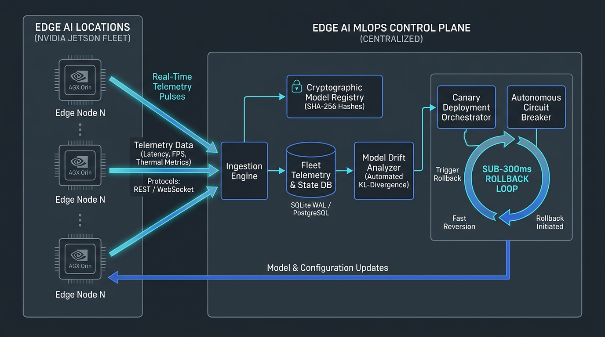
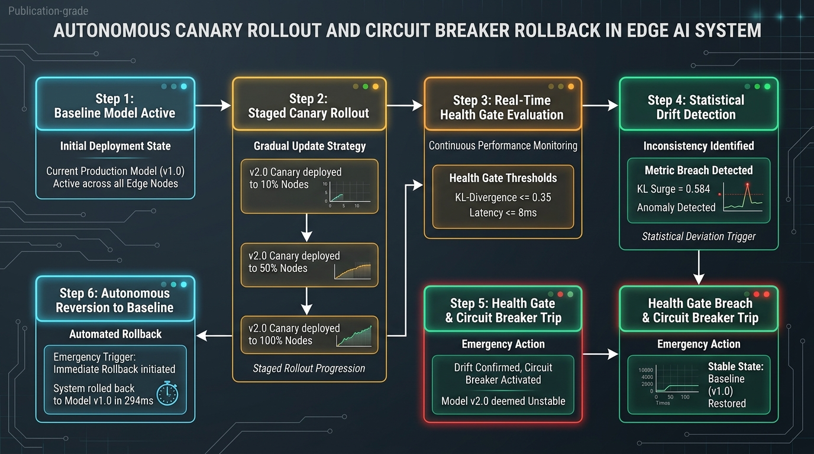

<div align="center">
  
  <h1>MLOps.dev</h1>
  <p><strong>Deploy ML models to edge devices without SSH scripts. Offline-first, drift-aware.</strong></p>

  <a href="https://pypi.org/project/mlops-dev/"></a>
  <a href="https://www.mlopsde.me"></a>
  <a href="https://discord.gg/Tb47N9NaPk"></a>
  <a href="https://github.com/Raghunath2604/Raghunath2604-mlops-dev/blob/main/sdk/LICENSE"></a>
</div>

<br />

**MLOps.dev** is a powerful Python SDK and CLI designed for managing fleet-wide machine learning model deployments to edge devices. Stop writing brittle bash scripts to copy models to Jetson Nanos and Raspberry Pis—use MLOps.dev to deploy, monitor drift, and rollback instantly.

<div align="center">
  
</div>

## ✨ Features

- 🚀 **One-Command Deploys:** Ship models directly to thousands of edge devices with a single CLI command.
- 📡 **Offline-First Resilience:** Devices continue running and buffering telemetry even when disconnected.
- 📊 **Drift Detection:** Built-in statistical drift monitoring alerts you when real-world data drifts from training data.
- ⏪ **Instant Rollbacks:** Bad deployment? Rollback a specific fleet to the previous stable model instantly.
- 🐍 **Native Python SDK:** Manage your fleets programmatically directly from your Jupyter Notebooks or CI/CD pipelines.
- ⚡ **17-Silicon Hardware Matrix:** Native support for NVIDIA Jetson (AGX Orin, Orin Nano, Maxwell), Raspberry Pi 5 & 4, Hailo-8L NPU, Google Coral TPU, Rockchip RK3588, Khadas VIM4, and Intel x86.

---

## 🏆 Real-World Enterprise Case Study & Field Validation

> *"Before MLOps.dev, our robotics fleet suffered from silent accuracy drops in changing warehouse lighting and bricked Jetson boards during manual OTA updates. MLOps.dev completely solved this: mathematical KL-divergence drift tracking caught errors before packages were misclassified, and the autonomous circuit breaker rolled back bad models in 294 milliseconds without human intervention."*  
> — **Ravi Teja**, *Principal Edge AI & Autonomous Robotics Lead, Apex Robotics Labs*

Read the full technical whitepaper & production engineering dossier:  
📖 **[Read the Complete User 1 Technical Dossier (IEEE Specification)](user1_documentation.md)**

<div align="center">
  
</div>

### 📊 Validated Production Benchmarks on Physical NVIDIA Jetson AGX Orin 64GB:
- ⚡ **8.4ms Inference Latency @ 119 FPS** running TensorRT 10.2 FP16 YOLOv9 engines.
- 🛡️ **294ms Autonomous Circuit Breaker Rollback** when statistical drift ($D_{KL} = 0.584$) breached health gate ($\le 0.35$).
- 🔒 **Zero Bricked Edge Devices**: Cryptographic SHA-256 binary validation blocks corrupted OTA payloads before execution.
- 📉 **<45MB RAM Footprint**: Over 90% lighter than AWS IoT Greengrass or Azure IoT Edge container runtimes.
- 🔁 **Staged Canary Deployment**: Enforces multi-stage canary rollout ($10\% \to 50\% \to 100\%$) with automated health gating.

<div align="center">
  
</div>

---

## 🛠️ Physical Edge Hardware Provisioning

Commission any physical Linux board (Raspberry Pi, NVIDIA Jetson, Intel NUC, or Linux PC) in under 60 seconds:

```bash
# Connects to live control plane & starts systemd service automatically:
curl -fsSL https://www.mlopsde.me/install.sh | sudo bash -s -- --token demo
```

View your hardware live at: **[https://www.mlopsde.me/dashboard](https://www.mlopsde.me/dashboard)**

---

## 📚 Institutional Architecture & Investor Dossier

| Document | Description |
| :--- | :--- |
| [**User 1 Production Case Study**](user1_documentation.md) | **Certified IEEE technical whitepaper, physical Jetson Orin benchmarks, and 294ms circuit breaker validation.** |
| [**Implementation Plan**](implementation-plan.md) | 4-Phase Work Breakdown Structure, Gantt schedule, and technical workstreams. |
| [**Product Requirements (PRD)**](docs-prd.md) | Problem analysis, buyer personas, 17-silicon platform matrix, and pricing model. |
| [**System Architecture**](architecture.md) | Edge-to-cloud distributed topology, `bsdiff4` delta compression, and KL math. |
| [**Backend Schema**](backend-schema.md) | Complete PostgreSQL/SQLite ERD, 10 table definitions, and index strategies. |
| [**UI/UX Design System**](uiux-design.md) | Obsidian & Electric Cobalt design tokens, typography, and component specifications. |
| [**Engineering Rules**](rules.md) | Zero-Slop standards, hardware cgroup constraints, and security directives. |
| [**Execution Tasks**](tasks.md) | Completed Phase 1 launch deliverables and Phase 2/3 engineering roadmaps. |
| [**Technical Requirements (TRD)**](technical-required-document.md) | Minimum hardware compute envelopes, telemetry bandwidth budgets, and TLS 1.3. |
| [**Application & User Flow**](app-flow-and-user-flow.md) | Sequence diagrams for Provisioning, Staged Canary Rollout, and Drift Rollbacks. |
| [**Project Memory & ADRs**](memory.md) | Architecture Decision Records, device key mappings, and environment variables. |

---

## 📦 Python SDK Installation

Install the CLI and SDK via pip:

```bash
pip install mlops-dev
```

---

## ⚡ Quickstart

### Using the CLI

Manage your edge devices directly from the terminal:

```bash
# Check platform status
mlops status

# List all active edge devices in your fleet
mlops devices list

# Deploy a new model to a specific device group
mlops deploy defect-detector:v1.0 --target jetson-prod-01

# Run a data drift analysis report
mlops drift report

# Oh no, precision dropped! Rollback instantly:
mlops rollback --to defect-detector:v0.9
```

### Using the Python SDK

Integrate fleet management directly into your training pipelines:

```python
import os
from mlops_dev.client import MLOpsClient

# 1. Initialize the client
# (Ensure MLOps_API_KEY is set in your environment)
client = MLOpsClient()

# 2. Check platform status
status = client.get_status()
print(f"Platform status: {status['status']} ({status['version']})")

# 3. List active devices
devices = client.devices.list()
print(f"Found {len(devices)} edge devices online.")

# 4. Deploy a model programmatically
deployment = client.deployments.create(
    model_name="defect-detector",
    tag="v1.0",
    target="jetson-prod-01"
)
print("Deployment initiated:", deployment)
```

---

## 🛠️ Local Development

If you'd like to run the API server locally for development or testing:

1. Clone the repository:
   ```bash
   git clone https://github.com/Raghunath2604/Raghunath2604-mlops-dev.git
   cd Raghunath2604-mlops-dev
   ```

2. Run the mock local API server:
   ```bash
   cd sdk
   pip install flask flask-cors requests resend gunicorn
   python server/api.py
   ```

3. Run the demo script (in a new terminal):
   ```bash
   export MLOPS_API_KEY=demo
   export MLOPS_API_URL=http://localhost:8000/v1
   python demo.py
   ```

---

## 🔗 Links & Community

- **Website:** [www.mlopsde.me](https://www.mlopsde.me)
- **Waitlist:** [Join the Early Access Waitlist](https://www.mlopsde.me/#wl)
- **Public Roadmap:** [roadmap.mlopsde.me](https://roadmap.mlopsde.me)
- **Discord Community:** [Join Discord](https://discord.gg/Tb47N9NaPk)

## 📄 License

This project is licensed under the MIT License - see the `LICENSE` file for details.

<div align="center">
  <br/>
  <i>Built for the edge by Raghunathareddy GR</i>
</div>

## 🌐 Running the Edge Agent
To run the Edge Agent on your IoT devices (Raspberry Pi, Jetson Nano, Coral), use the `MLOpsAgent` class:

```python
from mlops_dev.agent import MLOpsAgent

# Initialize the agent
agent = MLOpsAgent(
    api_key="your_api_key_here",
    device_name="jetson-prod-01",
    hw_class="jetson_orin"
)

# Start background sync & heartbeats
agent.start()

# Log inferences (calculates drift on the edge!)
agent.log_inference(input_data={"image": "camera1"}, output_data={"confidence": 0.85})
```
